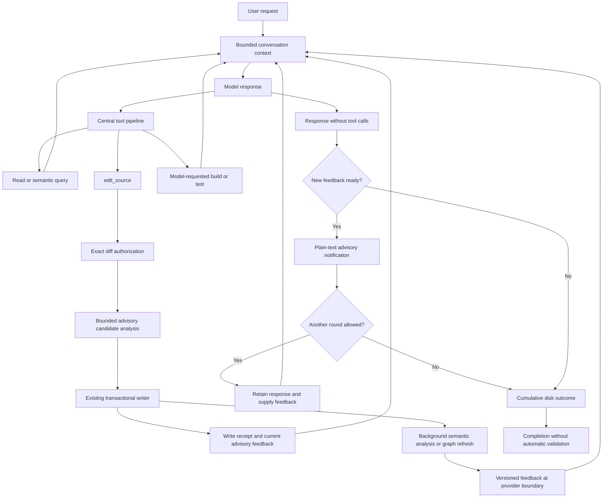

# Conversation and source editing

Threadsmith runs one ordinary model conversation. The model inspects relevant source, chooses an edit sequence, invokes advertised tools, and uses their results to continue the task. The host owns capability admission, trust, exact authorization, transactions, cancellation, durable effects and validation.

Assistant commentary accompanying tool calls remains in the same continuation group, in streamed order before the tool results. Later requests therefore retain progress updates and steering acknowledgements alongside the work they describe. Compaction treats the complete group together; native provider replay emits each assistant response once.

Retained provider reasoning does not disable active-turn compaction. Parent and child loops assess pressure including retained replay allowances. An accepted history rewrite removes private responses for summarized exchanges and rebinds retained complete exchanges to the new history without changing their signed payloads or wire tool-call identities. Candidate rejection leaves the original history and replay intact; compaction never reruns completed tools. Final provider preparation still checks the complete request, including its output reserve, against the configured context window.

`edit_source` accepts a rationale and an ordered list of create, replace, delete, move or supported semantic-rename operations. Host identities are assigned by the application. Supporting reads are independent of the write set. The existing scheduler preserves dependent tool order and the workspace edit lease serializes writes.

Enabled tools are advertised according to current trust and tool allow/deny policy, without phase, side-effect, or conversation opt-in filtering. Required approval is enforced at invocation. The tool pipeline retains policy, hooks, activity events, resource bounds and cancellation. The edit application captures current touched endpoints, resolves exact anchors, stages the diff and applies the surviving mutation approval policy. A declined edit returns a denied receipt; a changed source precondition returns a conflict requiring a fresh read. Neither outcome silently applies changes.

After authorization, the semantic owner analyzes the candidate within a bounded allowance. Compiler errors are advisory: well-formed authorized edits can temporarily introduce syntax or semantic errors. The effect journal persists exact before/after endpoint identities before invoking the existing writer. The writer rechecks preconditions and verifies final bytes. Disk outcome and semantic outcome remain separate.

Matching candidate results are reused after commit. Broader owner/dependent analysis continues through the existing compiler coordinator with generation fencing and bounded coverage. New diagnostics enter the ordinary conversation at a provider-compatible boundary; already delivered tool results are preserved. Graph replacement temporarily marks earlier applied analysis obsolete while retaining delivery tracking for its pending verified replacement. Missing or terminal obsolete analysis is reported explicitly. Model-facing receipts omit error totals while analysis is pending, obsolete, or has no completed project coverage; omitted totals are unknown, not zero.

Opt-in project-provided analyzers run through the same coordinator on changed owned documents, using project rule configuration without a host rule allowlist or analyzer deadline. Failed checks do not disable analyzers for later edits. Their status, document coverage and producer identities are separate from compiler totals. Matching promotion preserves pending analyzer work; supersession discards it. Optional checks never extend the immediate edit wait or final compiler feedback wait. Still-current results arriving after run completion can reach the next turn. Missing, disabled, skipped, partial and failed checks remain explicit. Shared diagnostic exclusions apply to both producers before reporting.

If newer advisory evidence arrives while the model writes its final response, the host supplies it through the same feedback boundary and permits a follow-up response within the configured round and budget limits. The previous response remains in history so outdated validation claims can be corrected. User-visible advisory notifications contain a plain-text coverage and error summary; serialized analysis is reserved for model context, not the output window. The host does not wait for pending analysis or start a mandatory repair cycle. Model instructions require repairing errors introduced by its changes before finishing, preserving the requested behavior and repository rules, and inspecting updated feedback. If repair conflicts with the request, the model must explain the conflict and ask for direction; unrelated existing errors remain outside scope. If no newer evidence is available, the ordinary final response ends model continuation and records cumulative disk effects; it does not launch validation. The model decides when to invoke build and test tools, with guidance to resolve incremental compiler errors and obtain current feedback first. Advisory compiler feedback never establishes build or test success. Cancellation or a later provider failure preserves already proven disk effects in the durable outcome.

Cancellation finalization records durable edit receipts without reacquiring the repository edit lease, so another run's pending exact approval cannot delay the cancelled terminal state. This outcome omits cumulative diff evidence and rollback availability and explicitly records that current disk state was not verified.

No executable plan, plan approval, step, tranche, proposal-generation turn or completion tool is required. A user-requested written plan is ordinary advisory conversation text.

See [mutation model](../architecture/mutation-model.md), [execution recovery](execution-resumption.md), [semantic refresh](semantic-refresh.md), and [validation pipeline](../architecture/validation-pipeline.md).

## Completed-turn receipts

Consequential turns archive one bounded historical receipt through the ordinary conversation store. Applied edits and explicit native build, analyzer, format and targeted-test observations share that receipt; validation-only turns also qualify. Ordinary answers and reads do not. Exploratory checks retain their authority and never satisfy an acceptance gate merely by appearing in history. The host does not launch validation to complete a receipt.

Checks retain the platform, invocation, effective scope and selector, typed result, available counts and source observation. Existing baseline capture identity and revision are observations, not proof of all source or built inputs. A changed baseline during a check is indeterminate; a later baseline makes it earlier-state evidence. Unobserved external edits and targeted tests using existing binaries keep final-code applicability unknown. Child handoffs containing suggested validation are not verification.

The run collects at most eight checks. Rendering admits at most 32 effect paths, eight checks, eight unresolved items and available diff metadata, plus up to eight recovery entries, then removes complete entries to fit 512 estimated tokens including historical framing. Omission counts remain explicit. Failed checks and applied effects take priority over passing checks. Recovery entries can identify retained bounded check observations and eligible final diffs. Text is sanitized and remains sensitive historical data under normal history modes and whole-turn budgets.

Receipt version and original session/run/message association persist atomically with the archive message. Repeated publication uses the same durable message identity. Clones retain original receipt provenance while acquiring their own archive identities. Old messages without receipt metadata remain ordinary historical text. Resume does not rerun checks or create validation claims.

An intact admitted receipt can authorize `read_active_turn_evidence` in a later turn of the same session and repository. The model supplies its evidence ID and optional line/column range, never the receipt body, owner ID or artifact hash. The host derives grants from typed metadata, verifies the exact visible receipt body, and charges the conditional schema in the complete request. Omission, rewriting, sensitivity exclusions, Stateless and Governed-memory-only modes revoke historical grants. Cloned receipts retain their original owner and grant no access in the clone. The current-run exact-source coverage proof remains separate and unchanged.

The artifact store retains only sanitized model-visible check output and eligible textual diffs: at most eight references, 1 MiB UTF-8 per body, 4 MiB per run and 64 MiB per session. Bodies share existing content-addressed blobs; receipt ownership is independent of a shared hash. Capture builds an index in chunks of at most 4,096 UTF-16 characters with UTF-8 byte offsets, line/column starts and metadata-bound checksums. Reads seek to the requested position, validate at most five chunks and use the shared 12,000-character pager; they never scan the full body for each page. Publication retries preserve existing associations. Unreferenced publication remnants expire through existing artifact cleanup.

Session-age retention expires recovery associations even if receipt text survives; removed receipt bodies also cease to authorize recovery. Missing or corrupt captures return unavailable without a file reread or tool rerun. Reopening the same session loads reference metadata with selected history and reads bodies only on demand. Historical evidence retains its capture-time path authorization; configured prohibited paths or narrower approved roots do not revoke receipt-authorized recovery. The ordinary tool pipeline still applies tool access policy, sanitization, cancellation and activity events. Historical output reports its origin run and original truncation, with current-source applicability explicitly unknown. Current redaction can further transform returned content.

Historical check/diff captures do not establish a complete file scope. If current approved roots exclude the repository root or any prohibited path is configured, historical body reads are denied using the same repository-scope restriction check as captured PR evidence. This conservative boundary avoids exposing old content after path policy tightens. Normal receipt text remains subject to history sensitivity policy. Redaction repair revokes old capture associations before deleting newly recognized secret-bearing bytes; those receipts subsequently return `Missing`.

Incomplete tool argument envelopes are rejected as a whole. For OpenAI-compatible providers, an invalid JSON invocation accompanied by a length finish reason or reported usage reaching the requested output allowance is diagnosed as output exhaustion. The ordinary bounded correction tells the model to split work into smaller calls or smaller file edits; it does not rerun earlier successful edits. Complete valid tool arguments remain acceptable at the allowance. Upstream model failures retain their own terminal diagnostic; cumulative edit finalization does not relabel them as compiler failures.
